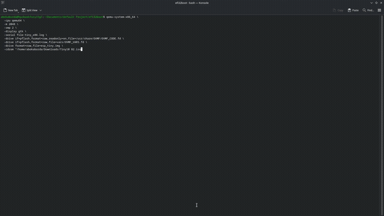

# efi32boot

**Your firmware is 64-bit. Your operating system only speaks 32-bit UEFI. This
is the bridge between them.**

Some machines shipped with 64-bit-only UEFI and no Compatibility Support
Module. They simply cannot start a 32-bit EFI bootloader — which is awkward if
the OS you need is 32-bit. `efi32boot` fixes that by carrying a complete
32-bit OVMF firmware inside an ordinary 64-bit EFI application.

It does not emulate a CPU. It drops the processor out of long mode, into
32-bit protected mode, and hands control to a real IA32 firmware. That
firmware then boots whatever 32-bit EFI OS you give it, exactly as it would
on native hardware.

> This is a research prototype, built with a lot of AI assistance and a lot of
> human debugging. It is not production software. Please read the safety note
> before pointing it at anything you care about.

## How it works

```
64-bit host firmware
    └── BOOTX64.EFI  (this project)
            ├── copies the embedded OVMF32 image below 4 GiB
            ├── rebases its SEC core, reserves the MEMFD region
            ├── leaves long mode -> compatibility mode -> 32-bit protected mode
            └── jumps into OVMF32 SEC
                    └── PEI -> DXE -> BDS -> any 32-bit EFI OS
```

The loader deliberately knows nothing about operating systems. It does not
look for `boot.wim`, `bootmgfw.efi`, `BCD` or any other named file, it does
not rewrite `BootOrder`, and it does not delete anything belonging to your OS.
Boot policy belongs to the inner firmware, which means the same binary works
for Linux, BSD, Windows or anything else that can boot as a 32-bit EFI image.

The platform layer is generic too: host-bridge IDs are only printed in the
log, and the ACPI power-management device is found by PCI class code from any
vendor. One build works on QEMU i440FX, Q35, VMware, and chipsets that do not
have a name yet. There is no "VMware edition".

## What's in here

| file | what it does |
| --- | --- |
| `main.c` | UEFI bootstrap, memory map, firmware relocation, mode hand-off |
| `transition.asm` | GDT, CR0/paging teardown, the 32-bit jump |
| `ovmf32_blob.S` | embeds `OVMF32.fd` into the EFI application |
| `tools/gen_ovmf32.py` | reads SEC offsets out of a firmware image |
| `build/ovmf32_constants.h` | generated from the shipped `OVMF32.fd` |
| `shared/` | platform-neutral quirks + the EDK2 patch/rebuild tooling |
| `edk2/` | git submodule: the patched [EDK2 fork](https://github.com/devtinoimao/edk2/tree/hosted-firmware) |
| `make_esp.sh` | builds a generic ESP containing just the loader |
| `test_qemu.sh` | OS-neutral smoke test — no OS files needed |

## Status

| environment | result |
| --- | --- |
| QEMU 10.2.2 `-M pc`, `-m 2048` | hand-off → SEC → PEI → DXE → BDS, no asserts |
| QEMU 10.2.2 `-M q35`, `-m 2048` | same; PM device found at `00:1F.0` by class `06:01` |
| VMware Workstation 26.0.1 | **passes.** `8086:7190`, PM at `00:07.3`, generic fallback, full chain to BDS, zero asserts |
| Forced unknown DID (`8086:DEAD`) | passes — proves nothing is keyed to a chipset |
| Real hardware, early Intel Macs | not validated end-to-end; detection and diagnostics only |

The original VMware failure was
`AcpiTimerLibConstructor: Unknown Host Bridge Device ID: 0x7190` followed by
an ASSERT in SEC. That was fixed in the firmware source, not papered over in
the loader: VID/DID are read-only PCI config registers, so no bootloader can
spoof them. A real VMware serial log is kept at `vmware_universal_test.log`.

## Build it

You need Python 3, `make`, a MinGW-w64 cross toolchain and NASM. The repo
ships a helper that installs a private toolchain so you don't have to touch
system packages:

```bash
git clone --recurse-submodules https://github.com/devtinoimao/efi32boot.git
cd efi32boot

./setup_toolchain.sh ./toolchain
export PATH="$PWD/toolchain/usr/bin:$PATH"

make all                 # -> BOOTX64.EFI
```

`OVMF32.fd` is included, so you do **not** need to build EDK2 just to compile
the loader. The submodule is only needed if you want to rebuild the firmware
yourself.

### Rebuilding the embedded firmware

The `edk2` submodule points at branch `hosted-firmware` of
`devtinoimao/edk2`. It contains a platform-neutral OVMF plus the local build
settings (IA32 MEMFD at `0x40000000`, KVM host-CPU MSR fix). If you cloned
without `--recurse-submodules`:

```bash
git submodule update --init --depth 1 edk2
```

The build runs inside the `localhost/edk2-builder:bookworm` podman image
(GCC 12, NASM, iasl, EDK2 BaseTools). From the combined workspace:

```bash
bash shared/rebuild_ovmf.sh
```

That rebuilds the IA32 firmware, regenerates `build/ovmf32_constants.h` and
relinks the loader. If you'd rather apply the change by hand,
`shared/patch_ovmf_platform.py` is idempotent and
`shared/patches/ovmf-platform-portability.patch` is a plain `git apply`-able
diff. `efi64boot` uses the same fork at a different MEMFD base.

## Test it

The smoke test needs no OS at all — it just proves the hand-off works:

```bash
./test_qemu.sh -M pc          # or -M q35
```

### Booting a real OS from an ISO you supply

No OS media is shipped with this repository. Bring your own ISO — a 32-bit
WinPE image is a perfectly good example, and so is a 32-bit Linux or BSD
installer. Build a plain ESP with the loader on it, then attach the ISO:

```bash
ISO=/path/to/your/winpe-x86.iso        # you provide this file

./make_esp.sh                          # -> build/esp.img
cp /usr/share/edk2/ovmf/OVMF_VARS.fd build/OVMF_VARS.fd

qemu-system-x86_64 -accel tcg -cpu qemu64 -M pc -m 2048 -smp 2 \
  -drive if=pflash,format=raw,readonly=on,file=/usr/share/edk2/ovmf/OVMF_CODE.fd \
  -drive if=pflash,format=raw,file=build/OVMF_VARS.fd \
  -drive format=raw,file=build/esp.img \
  -cdrom "$ISO" \
  -serial file:build/serial.log -display gtk -no-reboot
```

`./make_esp.sh <OS_TREE_DIR>` can also mirror an arbitrary EFI directory tree
onto the ESP if you'd rather boot from disk. Nothing in the ESP layout is
Windows-specific.

KVM works too (`-accel kvm -cpu host`), but the hosted OVMF32 needs the
FeatureControl MSR fix described in `docs/KVM_HOST_CPU.md`.

## Demo

The GIF and MP4 in `media/` show the whole chain starting up. They use a
32-bit Windows setup disc as the *example guest* — that is a test subject,
not a dependency.



Full video: [`media/efi32boot_qemu_demo.mp4`](media/efi32boot_qemu_demo.mp4)

## Be careful

- Do not install this as the primary bootloader on a machine you rely on.
- The mode switch depends on the host firmware's memory map; a bad map can
  hang before any output. Always capture the serial log.
- No Secure Boot guarantees.
- CSM enabled may send you down a legacy BIOS path and never reach UEFI at
  all. Test with CSM off first.
- If something fails, attach the serial log to the issue. That is genuinely
  the most useful thing you can send.

## Credits and licensing

Our code is **MIT licensed** — see `LICENSE`. The embedded `OVMF32.fd` is
derived from TianoCore EDK2, which is **BSD-2-Clause-Patent**; upstream
copyright and license notices remain in force for that work. The EDK2 fork
is referenced as a submodule rather than vendored, precisely so its
provenance stays clear. See `NOTICE` for the third-party breakdown.

Prior art worth reading: TianoCore OVMF, GRUB's `i386-efi` target, Intel
MultiArchUefiPkg (emulation-based), CSMWrap and SeaBIOS (CSM-based). This
project is a compatibility-mode host, not an emulator and not a legacy CSM.

No Windows ISOs, firmware blobs you downloaded yourself, or generated disk
images are distributed here. Get those separately, under their own licenses.

This project was heavily AI-assisted; the tested behaviour, the recovery
steps and the limitations above came from real debugging sessions on QEMU and
VMware. It is not a vibe-code dump, but it is still experimental firmware.
